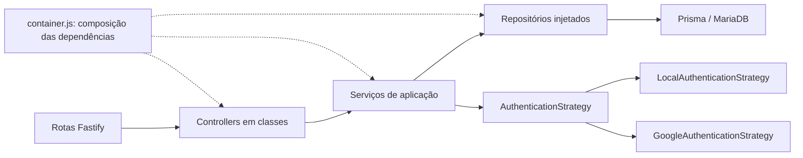

# Robótica Backend — POO e Strategy

API em **JavaScript ESM, Fastify 5 e Prisma 7**, implementada na branch `refactor` para a disciplina de arquitetura. Node.js 24 é a versão usada na validação. Não há etapa de compilação TypeScript: `npm start` executa JavaScript diretamente.

## Funcionalidades reunidas

Nenhuma das branches anteriores continha todas as funcionalidades:

| Branch de referência | Commit consultado | Conteúdo utilizado                                                                          |
| -------------------- | ----------------- | ------------------------------------------------------------------------------------------- |
| `develop`            | `cee6b44`         | Login local/Google, sessões, recuperação de senha, onboarding, autorização                  |
| `joao`               | `dbe2248`         | CRUDs de usuários, escolas, projetos, categorias e tutoriais; consulta da escola do usuário |
| `refactor`           | `6f7efe0`         | Base JavaScript/Fastify, estrutura modular e dependências                                   |

As URLs e os envelopes de resposta foram mantidos, por exemplo `{ message, user }`, `{ message, users }` e `{ message, accessToken, session }`. Usuários/escolas continuam restritos a administradores, conforme `develop`; categorias/tutoriais mantêm o acesso público da `joao`. Projetos agora têm rotas registradas e exigem autenticação e onboarding concluído.

Correções necessárias durante a integração: atualização de todos os campos declarados dos tutoriais, persistência de strings vazias válidas, respostas próprias de projetos (havia controllers copiados de escolas) e `schoolId` obrigatório na criação de projetos, como exige o banco. IDs são inteiros positivos. Erros de banco passam por um handler comum; mensagens incorretas copiadas entre recursos foram corrigidas.

## Arquitetura



- **Controllers** traduzem HTTP, validam entradas com Zod e montam respostas. Não consultam o Prisma.
- **Serviços** coordenam regras, sessões e onboarding, sem depender de request/reply do Fastify.
- **Repositórios** encapsulam consultas e transações. `PrismaRepository` reúne as operações comuns; `UserRepository` e `AuthRepository` tratam consultas específicas.
- **Entidade `User`** encapsula a regra de conclusão do onboarding e sua representação pública, excluindo senha e identidade Google interna.
- **Injeção por construtor** permite substituir persistência, email e cliente Google nos testes. As dependências reais são montadas em `src/container.js`.
- **Herança e composição**: `UserService` especializa `CrudService`; `UserController` especializa `CrudController`; estratégias especializam `AuthenticationStrategy`. Recursos com CRUD equivalente reutilizam essas classes por composição e definições explícitas em `modules/resources.js`.

### Onde o Strategy aparece

`AuthService.login(provider, credentials)` seleciona uma implementação no `Map` de estratégias e chama somente `authenticate(credentials)`. O serviço não contém condições sobre os detalhes de senha ou tokens Google.

```js
const strategies = new Map([
  ["local", new LocalAuthenticationStrategy(users, passwords)],
  [
    "google",
    new GoogleAuthenticationStrategy(users, passwords, googleClient, config),
  ],
])
```

A estratégia local consulta o usuário e verifica a senha. A Google verifica assinatura/audience do ID token, email verificado e domínio permitido; depois cria ou vincula o usuário. Ambas retornam um usuário para o mesmo fluxo de emissão de sessão. Para adicionar um provedor, implemente `authenticate` e registre a nova instância no container; o algoritmo do serviço permanece igual. O teste `AuthService accepts a new Strategy` demonstra essa extensão.

### Estrutura

```text
src/
  config/env.js                 Validação das variáveis
  core/
    database/                   Prisma e repositório base
    errors/                     AppError e tradução de erros
    http/                       Controller/serviço CRUD e validação compartilhados
    security/                   Hash de senha e autorização
  modules/
    auth/                       Controller, serviço, repositório, tokens e estratégias
    users/                      Especializações de usuário
    schools/                    Validação de escolas
    projects/                   Validação de projetos
    categories/                 Validação de categorias
    tutorials/                  Validação de tutoriais
    resources.js                Contratos dos CRUDs compartilhados
  container.js                  Composição das dependências
  app.js                        Aplicação testável, sem abrir porta
  server.js                     Banco, servidor e encerramento
test/                           Regressões HTTP/serviços e integração real de banco
```

## Instalação e execução

```bash
npm ci
cp .env.example .env  # somente se ainda não existir
```

Configure `DATABASE_URL` para um banco MySQL/MariaDB e preencha `JWT_ACCESS_SECRET` com um valor aleatório de pelo menos 32 caracteres (por exemplo, gere com `openssl rand -hex 32`). As antigas variáveis `DATABASE_HOST`, `DATABASE_USER`, etc. não são mais necessárias: aplicação e Prisma usam a mesma URL.

```bash
npm run db:generate
npm run db:migrate
npm run db:status
npm run db:seed
npm run dev
```

`npm run db:seed` é idempotente e cria dados locais para teste. O usuário demo é `demo@robotica.local` com a senha `Demo@123456`; não use essas credenciais fora do ambiente local.

`npm start` inicia sem watch; `GET /status` deve responder `{"status":"ok","message":"API  online"}`. O servidor conecta ao banco antes de aceitar requisições e encerra suas conexões em SIGINT/SIGTERM. Dependências instaladas e dados em disco podem ser retidos, mas os processos precisam ser iniciados novamente em cada ambiente.

### Banco e migrações

O schema combina as entidades de autenticação da `develop` com projetos, categorias e tutoriais da `joao`. O gerador `prisma-client-js` disponibiliza um cliente JavaScript importável por `@prisma/client`, adequado à base ESM da `refactor`.

As migrações históricas foram reunidas em ordem, sem exclusão de dados. Na migração `20260615231929_1_1`, `ALTER TABLE tutorial` foi corrigido para `ALTER TABLE Tutorial`: o nome anterior falha no MariaDB Linux com nomes sensíveis a maiúsculas. Se você já aplicou a versão antiga dessa migração em outro sistema, compare o schema e o histórico em uma cópia do banco antes de migrar; o checksum desse arquivo difere. Não use reset em um banco com dados. Esta refatoração não executa reset, drop de banco ou migração de produção automaticamente.

### Autenticação e integrações

- Senhas novas usam Argon2id. A verificação continua aceitando hashes bcrypt existentes; não é preciso recadastrar usuários.
- Access tokens mantêm `userId`, `role` e `onboardingStatus`. Use `Authorization: Bearer TOKEN`.
- Refresh tokens ficam em cookie `refreshToken` HttpOnly, SameSite=Lax e Secure em produção. O cabeçalho `Authorization: Refresh TOKEN` também continua aceito. O banco armazena somente hashes e a rotação rejeita reutilização concorrente.
- Redefinição de senha consome o token e revoga as sessões numa transação. Access tokens já emitidos expiram normalmente, como antes.
- Google exige `GOOGLE_CLIENT_ID` e `GOOGLE_ALLOWED_DOMAIN`. São necessários HTTPS para os serviços Google usados pela biblioteca e uma conta do domínio. Os testes locais usam um cliente Google substituível e não comprovam acesso a uma conta externa.
- Email usa `SMTP_*`, `MAIL_FROM` e `APP_BASE_URL`. Sem SMTP em desenvolvimento, os links ficam em arquivos privados de `.local/mail/`, em vez de aparecer nos logs. Em produção, a ausência de SMTP retorna 503 para a operação de envio. Nunca versione esses arquivos ou exponha links de redefinição.
- POSTs de autenticação têm limite de 30 requisições por minuto/IP. Em implantação atrás de proxy, configure a confiança no proxy conforme a infraestrutura, sem confiar indiscriminadamente em cabeçalhos externos.

**Regra herdada a revisar antes de produção:** `/auth/register` continua aceitando `role: ADMIN`, como a `develop`. Portanto, cadastro público pode criar administradores. Isso foi mantido para compatibilidade, não deve ser interpretado como um modelo seguro de provisionamento de administradores. Categorias/tutoriais públicos também refletem a branch original.

## Rotas

| Método         | Caminho                                         | Acesso                               |
| -------------- | ----------------------------------------------- | ------------------------------------ |
| GET            | `/status`                                       | Público                              |
| POST           | `/auth/register`, `/auth/login`, `/auth/google` | Público                              |
| POST           | `/auth/refresh`, `/auth/logout`                 | Refresh token quando aplicável       |
| POST           | `/auth/forgot-password`, `/auth/reset-password` | Público/token de recuperação         |
| GET            | `/auth/me`                                      | Bearer                               |
| POST           | `/auth/onboarding`                              | Professor autenticado                |
| GET/POST       | `/users`, `/schools`                            | Admin                                |
| GET/PUT/DELETE | `/users/:id`, `/schools/:id`                    | Admin                                |
| GET            | `/users/:id/school`                             | Admin                                |
| GET/POST       | `/projects`                                     | Autenticado com onboarding concluído |
| GET/PUT/DELETE | `/projects/:id`                                 | Autenticado com onboarding concluído |
| GET/POST       | `/categories`, `/tutorials`                     | Público, como na `joao`              |
| GET/PUT/DELETE | `/categories/:id`, `/tutorials/:id`             | Público, como na `joao`              |

## Validação

```bash
npm run check   # sintaxe JavaScript
npm run lint
npm test        # HTTP, serviços, senhas reais e Strategy; persistência em memória
```

Os testes cobrem validação, autorização, cadastro/login, bcrypt legado, Argon2, cookies, expiração, rotação concorrente/replay, logout, recuperação de senha, onboarding, CRUDs e substituição de estratégia. O banco em memória é um substituto da fronteira Prisma, não comprova SQL, constraints ou conexão real.

Para a integração real, use um **banco exclusivo de testes** com as migrações aplicadas e defina `TEST_DATABASE_URL` de forma segura:

```bash
npm run test:db
```

Sem essa variável o teste é explicitamente pulado. Com ela, valida Prisma/MariaDB, JSON dos tutoriais, relações, constraints, rotação e transação de recuperação de senha. Remove somente os registros que criou. O workflow `.github/workflows/test.yml` prepara um MariaDB descartável e executa essas etapas no GitHub Actions; adicionar o workflow não significa que a execução remota já passou.

No ambiente de nuvem usado para esta alteração, as sete migrações SQL foram executadas com sucesso em um MariaDB 11.4 descartável: as oito tabelas foram criadas, um tutorial com JSON foi inserido e a restrição de exclusão de categoria em uso foi confirmada. Essa validação SQL não substitui a integração do cliente Prisma.

A política retornou HTTP 403 para `binaries.prisma.sh`, impedindo a geração e validação pelo CLI do Prisma e a integração real com o ORM. Libere o domínio nas configurações do ambiente e execute `db:generate`, `db:migrate` e `test:db` antes de considerar essa parte validada. Não desative verificação TLS ou checksums para contornar o bloqueio.
